<a href="https://lnbodicherla.dev">
  <picture>
    <source media="(prefers-color-scheme: dark)" srcset="assets/banner-dark.svg">
    
  </picture>
</a>

Senior Machine Learning Engineer with 6+ years across data science, machine learning and applied AI.

- **Now:** Senior ML Engineer at Quantiphi, building a GCP document AI platform for recorded property records (Document AI, Gemini on Vertex AI, entity resolution, grounded Q&A).
- **Before:** Forward Deployed Engineer at C3 AI (agentic process optimization for manufacturing), Senior AI/ML Engineer at PwC (fine-tuned LLMs, RAG, multi-agent document workflows), ML Engineer at BCBS (real-time risk scoring, GNNs), Data Scientist at Jotter.ai (computer vision).
- **Open to:** senior ML / AI engineering roles.

### Featured projects

| Project | What it is |
|---|---|
| [lumen-grid](https://github.com/ln-bodicherla/lumen-grid) | A neon-grid, sci-fi desktop for Omarchy (Hyprland + Quickshell): live 3D wallpaper, window effects, lock screen and a plain-English command bar. |
| [skillgate](https://github.com/ln-bodicherla/skillgate) | A firewall for AI agent skill updates. Runs old and new versions in a sandbox and holds the update if it starts doing something new. |
| [sonic-land](https://github.com/ln-bodicherla/sonic-land) | A keyboard-driven tiling window manager for macOS, with workspaces, rules, scratchpads and a CLI. |
| [mlmap](https://github.com/ln-bodicherla/mlmap) | *The Complete AI/ML Engineer*: a free, open textbook in 26 chapters, from foundations to LLMs and production systems. |
| [recall-mac](https://github.com/ln-bodicherla/recall-mac) | A macOS screen-memory app: periodic captures, on-device OCR and a searchable timeline. |
| [claude-code-gui](https://github.com/ln-bodicherla/claude-code-gui) | A native SwiftUI app for the Claude Code CLI, with projects, sessions, diffs and permission prompts. |

<!-- repo-index:start -->

### All projects

<b>AI agents & LLM tools</b> (12)

| Repo | Description |
|---|---|
| [skillgate](https://github.com/ln-bodicherla/skillgate) | Firewall for AI agent skill updates: sandboxes old and new versions and flags changes in what a skill actually does. |
| [vibectl](https://github.com/ln-bodicherla/vibectl) | Terminal copilot that indexes a repo (tree-sitter, dependency graph) and uses LLMs to flag architecture drift and bugs. |
| [fluxly-agentic](https://github.com/ln-bodicherla/fluxly-agentic) | Background finance agents for Fluxly: Plaid webhooks feed bill, spend, cashflow and subscription agents that emit tasks. |
| [prism-fxly](https://github.com/ln-bodicherla/prism-fxly) | Multi-model AI chat app with side-by-side compare mode for Claude, Llama, Gemini, DeepSeek and others. |
| [potluck](https://github.com/ln-bodicherla/potluck) | Pool Macs, PCs and GPUs with people you trust to run large AI models together, as a friendly layer over exo. |
| [super-memory-mcp](https://github.com/ln-bodicherla/super-memory-mcp) | MCP server giving LLM clients shared long-term memory with semantic search (sentence-transformers, FAISS, SQLite). |
| [MediMemory](https://github.com/ln-bodicherla/MediMemory) | MCP server extending SuperMemory with medical image embedding (DenseNet) and similar-case search; synthetic-data demo. |
| [unifiedAI](https://github.com/ln-bodicherla/unifiedAI) | ChatGPT-style chat UI for Gemini and OpenRouter models, built with Next.js, TypeScript and tRPC. |
| [crewai-multi-agent](https://github.com/ln-bodicherla/crewai-multi-agent) | Role-based multi-agent system with CrewAI (researcher, developer, reviewer, data engineer agents). |
| [langgraph-multi-agent](https://github.com/ln-bodicherla/langgraph-multi-agent) | LangGraph multi-agent workflows for generating data pipelines and reviewing code. |
| [rag-document-qa](https://github.com/ln-bodicherla/rag-document-qa) | Document Q&A with RAG: LangChain, ChromaDB, hybrid BM25 + dense retrieval and a FastAPI/WebSocket API. |
| [graphrag-knowledge-qa](https://github.com/ln-bodicherla/graphrag-knowledge-qa) | GraphRAG question answering: builds an entity-relationship graph from documents and retrieves via graph traversal. |

<b>Machine learning: fraud, risk & anomaly detection</b> (7)

| Repo | Description |
|---|---|
| [fraud-detection-ensemble](https://github.com/ln-bodicherla/fraud-detection-ensemble) | Insurance-claims fraud detection with a stacked XGBoost, LightGBM and CatBoost ensemble and SHAP explanations. |
| [gnn-fraud-rings](https://github.com/ln-bodicherla/gnn-fraud-rings) | Graph attention network (PyTorch Geometric) for detecting fraud rings in synthetic provider-patient graphs. |
| [node2vec-fraud-detection](https://github.com/ln-bodicherla/node2vec-fraud-detection) | Node2Vec embeddings of transaction graphs fed to XGBoost and random forest classifiers for fraud detection. |
| [anomaly-detection-system](https://github.com/ln-bodicherla/anomaly-detection-system) | Unsupervised anomaly detection on transactions combining Isolation Forest and an autoencoder. |
| [vae-anomaly-detection](https://github.com/ln-bodicherla/vae-anomaly-detection) | Variational autoencoder anomaly detection using reconstruction probability with uncertainty estimates. |
| [credit-risk-scoring](https://github.com/ln-bodicherla/credit-risk-scoring) | Credit risk scoring with LightGBM, Optuna tuning, monotonic constraints and scorecard generation. |
| [model-explainability-toolkit](https://github.com/ln-bodicherla/model-explainability-toolkit) | Model explanation toolkit using SHAP and LIME with global importance, fairness checks and reports. |

<b>Machine learning: time series</b> (2)

| Repo | Description |
|---|---|
| [lstm-predictive-maintenance](https://github.com/ln-bodicherla/lstm-predictive-maintenance) | LSTM with temporal attention for remaining-useful-life prediction from multivariate sensor data. |
| [temporal-fusion-transformer](https://github.com/ln-bodicherla/temporal-fusion-transformer) | Temporal Fusion Transformer for multi-horizon remaining-useful-life forecasting with interpretable attention. |

<b>Machine learning: LLMs, NLP & documents</b> (5)

| Repo | Description |
|---|---|
| [llm-finetuning-qlora](https://github.com/ln-bodicherla/llm-finetuning-qlora) | QLoRA fine-tuning pipeline for Hugging Face causal LMs: 4-bit training, evaluation and adapter merging. |
| [deepspeed-llm-finetuning](https://github.com/ln-bodicherla/deepspeed-llm-finetuning) | Full-parameter LLM fine-tuning with DeepSpeed ZeRO stage 2/3 across multiple GPUs. |
| [nlp-ner-transformers](https://github.com/ln-bodicherla/nlp-ner-transformers) | Named entity recognition by fine-tuning BERT/RoBERTa with seqeval evaluation and a FastAPI endpoint. |
| [spacy-custom-ner](https://github.com/ln-bodicherla/spacy-custom-ner) | Custom spaCy NER pipeline combining rule-based patterns with a trained statistical model. |
| [document-ai-extraction](https://github.com/ln-bodicherla/document-ai-extraction) | Field extraction from invoices, receipts and forms with LayoutLMv3 and Donut. |

<b>Machine learning: computer vision & generative models</b> (7)

| Repo | Description |
|---|---|
| [clip-visual-search](https://github.com/ln-bodicherla/clip-visual-search) | Text-to-image and image-to-image search with CLIP embeddings and FAISS indexes. |
| [blip2-image-captioning](https://github.com/ln-bodicherla/blip2-image-captioning) | Image captioning and visual question answering with BLIP-2, with caption-based image search. |
| [yolov8-object-detection](https://github.com/ln-bodicherla/yolov8-object-detection) | YOLOv8 object detection pipeline: dataset prep, training, evaluation and an inference API. |
| [detectron2-instance-segmentation](https://github.com/ln-bodicherla/detectron2-instance-segmentation) | Instance segmentation with Detectron2 Mask R-CNN: training, evaluation and inference. |
| [segment-anything-api](https://github.com/ln-bodicherla/segment-anything-api) | API service for Meta's Segment Anything with point, box and automatic mask prompts. |
| [stable-diffusion-controlnet](https://github.com/ln-bodicherla/stable-diffusion-controlnet) | Stable Diffusion XL with ControlNet conditioning (depth, Canny, OpenPose) for controlled image generation. |
| [instructpix2pix-editor](https://github.com/ln-bodicherla/instructpix2pix-editor) | Text-instructed image editing with InstructPix2Pix, with batch and iterative editing. |

<b>Machine learning: serving & MLOps</b> (5)

| Repo | Description |
|---|---|
| [onnx-model-optimization](https://github.com/ln-bodicherla/onnx-model-optimization) | Convert PyTorch models to ONNX, apply quantization and TensorRT, and benchmark latency and throughput. |
| [bentoml-model-serving](https://github.com/ln-bodicherla/bentoml-model-serving) | Model serving with BentoML: adaptive batching, Bento packaging and containerized deployment. |
| [mlops-model-serving](https://github.com/ln-bodicherla/mlops-model-serving) | MLOps example: MLflow tracking, FastAPI serving, Docker, A/B testing and drift monitoring. |
| [fastapi-ml-microservice](https://github.com/ln-bodicherla/fastapi-ml-microservice) | FastAPI model-serving microservice with Docker, Kubernetes manifests, Prometheus metrics and rate limiting. |
| [spring-boot-ml-api](https://github.com/ln-bodicherla/spring-boot-ml-api) | Spring Boot (Java) REST service for fraud-model inference with Resilience4j and Micrometer metrics. |

<b>Learning resources</b> (2)

| Repo | Description |
|---|---|
| [mlmap](https://github.com/ln-bodicherla/mlmap) | The Complete AI/ML Engineer: a free open textbook from foundations to frontier, 26 chapters with a searchable docs site. |
| [MachineLearning](https://github.com/ln-bodicherla/MachineLearning) | Academic ML notebooks: EDA on the Haberman cancer dataset and an SVM voice gender classifier. |

<b>Linux desktop</b> (2)

| Repo | Description |
|---|---|
| [lumen-grid](https://github.com/ln-bodicherla/lumen-grid) | Neon-grid sci-fi desktop for Omarchy (Hyprland + Quickshell): live 3D wallpaper, window effects, lock screen, launcher. |
| [gnome-nautilus](https://github.com/ln-bodicherla/gnome-nautilus) | Personal copy of GNOME Nautilus (Files) v50 with custom modifications, built with Meson. |

<b>macOS & iOS apps</b> (11)

| Repo | Description |
|---|---|
| [sonic-land](https://github.com/ln-bodicherla/sonic-land) | Keyboard-driven tiling window manager for macOS: BSP and other layouts, workspaces, rules, scratchpads, sonicctl CLI. |
| [recall-mac](https://github.com/ln-bodicherla/recall-mac) | macOS screen-memory app: periodic screenshots, Vision OCR and a searchable timeline, plus a markdown notes editor. |
| [claude-code-gui](https://github.com/ln-bodicherla/claude-code-gui) | Native macOS SwiftUI chat interface for the Claude Code CLI with projects, sessions, diffs and permission dialogs. |
| [WireAudio](https://github.com/ln-bodicherla/WireAudio) | macOS audio routing and mixing app: per-app levels, audio graph, DSP effects and virtual devices. |
| [action-prompter](https://github.com/ln-bodicherla/action-prompter) | macOS menu bar app that notifies you when Claude Code, Cursor or Codex is waiting on a permission prompt. |
| [fxly-wall](https://github.com/ln-bodicherla/fxly-wall) | macOS wallpaper manager that pulls from Unsplash and Pixabay, with collections, scheduling and Core Image filters. |
| [zune-project](https://github.com/ln-bodicherla/zune-project) | Minimal cross-platform email client: SwiftUI (macOS/iOS) and Android apps with a shared Node.js IMAP/SMTP backend. |
| [BoringCalendar](https://github.com/ln-bodicherla/BoringCalendar) | Retro pixel-styled iOS calendar app built with SwiftUI and MVVM, offline-first. |
| [BoringNotes](https://github.com/ln-bodicherla/BoringNotes) | Retro 90s-styled iOS notes app built with SwiftUI, MVVM and Core Data. |
| [BoringRadio](https://github.com/ln-bodicherla/BoringRadio) | Retro analog-radio iOS app for internet radio and podcasts, with tuning sounds and haptics, in SwiftUI. |
| [BoringWeather](https://github.com/ln-bodicherla/BoringWeather) | Deliberately plain, retro monospaced iOS weather app built with SwiftUI. |

<b>Android apps</b> (3)

| Repo | Description |
|---|---|
| [cubes-launcher](https://github.com/ln-bodicherla/cubes-launcher) | Android launcher with resizable app tiles plus bundled phone, messages, contacts, clock, weather and keyboard apps. |
| [fluxlyapp-android](https://github.com/ln-bodicherla/fluxlyapp-android) | Android client for the Fluxly personal-finance app: accounts, spending and an AI assistant view. |
| [BoringWeatherAndroid](https://github.com/ln-bodicherla/BoringWeatherAndroid) | Android port of BoringWeather: retro-styled weather app in Kotlin using Open-Meteo. |

<b>Web apps</b> (12)

| Repo | Description |
|---|---|
| [fluxlyapp-ui](https://github.com/ln-bodicherla/fluxlyapp-ui) | Mobile-first React web app for credit card management and spending insights using Plaid. |
| [avancio-central](https://github.com/ln-bodicherla/avancio-central) | Mobile-first credit card statement tracker using Plaid, with Wallet-style statement cards. |
| [fxly](https://github.com/ln-bodicherla/fxly) | FXLY Dispatch: FastAPI financial news site with AI-written articles, live ticker and market prediction games. |
| [gym-tuner](https://github.com/ln-bodicherla/gym-tuner) | AI fitness companion web app: workout suggestions, goal tracking and progress analytics (React + Supabase). |
| [gym-tuner-backend](https://github.com/ln-bodicherla/gym-tuner-backend) | Small Python/Node backend for Gym Tuner with a Gemini response schema and sample workout data. |
| [subbed-tube-search-view](https://github.com/ln-bodicherla/subbed-tube-search-view) | YouTube channel search and viewer built with React and Supabase edge functions. |
| [AtlasFlow](https://github.com/ln-bodicherla/AtlasFlow) | Interactive 3D globe (globe.gl) that turns natural-language questions into map scenes with pins, arcs and flows. |
| [project-people](https://github.com/ln-bodicherla/project-people) | Privacy-first image sharing site built with Node.js, Express and SQLite. |
| [socialok](https://github.com/ln-bodicherla/socialok) | Next.js mock social feed that generates posts through the Grok API. |
| [WhatSlack](https://github.com/ln-bodicherla/WhatSlack) | Chrome extension that restyles WhatsApp Web with an iMessage-like theme. |
| [newsblock_ui](https://github.com/ln-bodicherla/newsblock_ui) | React front end for Newsblock, a news aggregation web app. |
| [newsblock_api](https://github.com/ln-bodicherla/newsblock_api) | Spring Boot REST API for Newsblock articles, categories and users. |

<b>Data engineering</b> (6)

| Repo | Description |
|---|---|
| [pipelineforge-fxly](https://github.com/ln-bodicherla/pipelineforge-fxly) | Drag-and-drop visual ETL pipeline builder in React with AI-assisted node configuration. |
| [airflow-etl-pipeline](https://github.com/ln-bodicherla/airflow-etl-pipeline) | Airflow DAGs for a bronze/silver/gold claims ETL with data-quality checks, SCD Type 2 and model retraining. |
| [prefect-data-pipeline](https://github.com/ln-bodicherla/prefect-data-pipeline) | Prefect flows for a bronze/silver/gold healthcare-claims pipeline with retries and caching. |
| [feast-feature-store](https://github.com/ln-bodicherla/feast-feature-store) | Feast feature store for claims fraud features with file offline store and Redis online store. |
| [streaming-fraud-detection](https://github.com/ln-bodicherla/streaming-fraud-detection) | Kafka and Spark Structured Streaming pipeline for real-time transaction fraud scoring. |
| [newsblock_etl](https://github.com/ln-bodicherla/newsblock_etl) | Java ETL job that fetches and categorizes news articles for the Newsblock app. |

<b>Other</b> (2)

| Repo | Description |
|---|---|
| [usm-demo](https://github.com/ln-bodicherla/usm-demo) | Spring Boot and MongoDB demo service for mobile usage and billing-cycle data. |
| [Intra-Network-System-for-Communication---Java](https://github.com/ln-bodicherla/Intra-Network-System-for-Communication---Java) | Java Swing LAN chat client/server using RMI, with file transfer and emoji. |

<!-- repo-index:end -->

### Open-source contributions

- [anthropics/claude-agent-sdk-python](https://github.com/anthropics/claude-agent-sdk-python/pulls?q=is%3Apr+author%3Aln-bodicherla): fixes to message parsing, transport shutdown and the control protocol
- [Alexays/Waybar](https://github.com/Alexays/Waybar/pull/5398): battery percentage rounding with `full-at`
- [omacom/try-omarchy](https://github.com/omacom/try-omarchy/pulls?q=is%3Apr+author%3Aln-bodicherla): guest image fixes

### Skills

**ML & AI:** PyTorch, Hugging Face, LLM fine-tuning (QLoRA/PEFT), RAG, agents & MCP, LLM evaluation, GNNs, computer vision
**Platforms:** GCP (Vertex AI, Document AI, BigQuery), AWS (SageMaker, Bedrock), Databricks, C3 Agentic AI Platform
**Engineering:** Python, SQL, TypeScript, Swift, Kotlin, FastAPI, PySpark, Kafka, Docker, Kubernetes, Terraform

### Contact

[lnbodicherla.dev](https://lnbodicherla.dev) · [LinkedIn](https://www.linkedin.com/in/narasimha94/)
